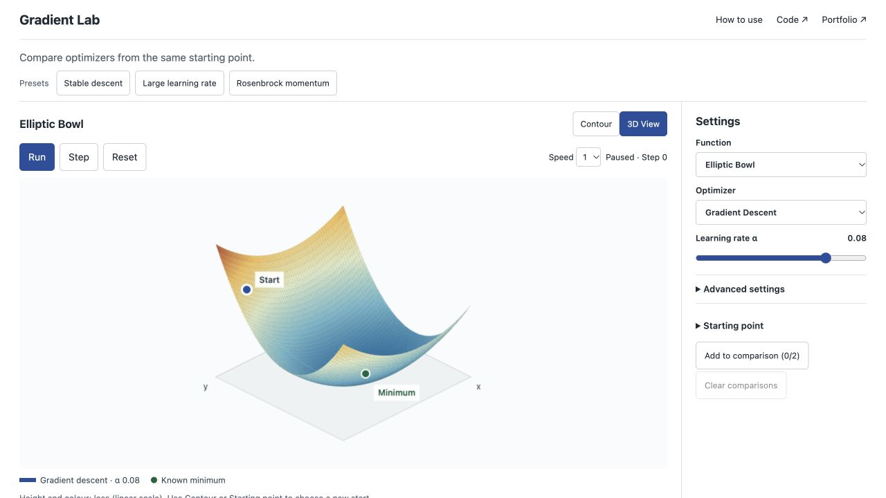

# Gradient Lab

How do update rules and learning rates change the path down the **same objective from the same starting point**?

[Interactive experiment](https://gradient.m21264551.com) · [Case study](docs/case-study.md)



## Try it

1. Begin on the paused elliptic bowl. Take one **Step** and inspect the numeric update below the plot.
2. **Add to comparison**, switch from gradient descent to Adam, and compare the paths and losses.
3. Try the excessive-rate preset. The path can leave the viewport and terminate at an explicit safety limit.
4. Move to Rosenbrock or either non-convex surface. Share the current configuration or download all compared traces.

The two retained runs plus the current run share a function and start. Changing either clears comparisons. Reset rewinds the same seeded experiment; **New start** explicitly changes it. The 3D bowl opens paused. Contour is an equal-scale overhead view with click-to-place coordinates. **How to use** explains the surface and offers three experiments below the tool; returning preserves the current selection.

## Mathematics

For gradient `gₜ`, learning rate `α`, and zero-initialized moments:

- Gradient descent: `θₜ₊₁ = θₜ − αgₜ`.
- Heavy-ball momentum: `vₜ = βvₜ₋₁ − αgₜ`; `θₜ₊₁ = θₜ + vₜ`.
- Adam: `mₜ = β₁mₜ₋₁ + (1−β₁)gₜ`; `vₜ = β₂vₜ₋₁ + (1−β₂)gₜ²`. Bias-correct both moments, then `θₜ₊₁ = θₜ − α m̂ₜ / (√v̂ₜ + ε)`. Here β₂ = 0.999 and ε = 10⁻⁸; the momentum control sets β₁.

Optional noise is independent uniform `U(−σ, σ)` per gradient component, generated from the recorded seed. Equal learning rates do not imply equal tuning across optimizers.

There is **no hidden update cap or parameter projection**. Rendering clips paths to the viewport without changing their state. A run stops on:

- gradient norm below 10⁻⁸ when noise is zero (stationarity, not proof of a minimum);
- the configured iteration limit (220 default, up to 2,000 in a validated configuration);
- a non-finite calculation;
- an explicit safety limit: coordinate magnitude >10⁶ or absolute loss >10¹².

Numerical and safety stops preserve the last valid state and record the attempted iteration. The UI separately identifies closeness to a known minimum. Saddle + Walls has two symmetric minima; the origin is a stationary saddle. Ripple Basin's minimum is obtained by root-solving its analytic derivative. Tests check gradients by independent finite differences and check all marked minima.

The bowl uses linear loss for height and colour; other surfaces use labelled log(1 + loss). The loss chart uses its labelled log transform. A shared orthographic projection fits the mesh, paths and minima uniformly on resize; contour axes have equal pixels per unit. All transforms affect rendering only.

## Architecture and result contract

`src/lib/objectives.js` owns exact objectives, seeded simulation, configuration validation and the version-1 result contract. A result includes `trace`, `termination`, `attemptedIteration` and diagnostics. `App.jsx` owns playback and up to three comparison configurations. `LandscapeCanvas.jsx` renders them through shared mappings in `src/lib/landscape.js` without advancing the mathematics.

A shared URL contains one validated version-1 configuration. Unknown versions and invalid values produce a visible explanation. Downloaded JSON preserves every retained configuration, full trace, seed and termination reason. No server, accounts, uploads or external inference are needed.

## Run and verify

Node 20.19 or later:

```sh
npm ci
npm run dev
npm run lint
npm run test:unit
npx playwright install chromium firefox webkit
npm run test:e2e
npm run test:a11y
npm run test:visual
npm run build
npm run budget
```

Reference tests independently calculate GD, heavy-ball and Adam updates. Regression checks cover seeded noise, honest divergence, invalid URLs, reset, retained comparisons, and mathematical independence from playback. Browser tests exercise Chromium, Firefox and WebKit; axe checks desktop/mobile accessibility. Screenshot baselines are generated on macOS, matching CI. Review deliberate visual changes before running `npm run test:visual -- --update-snapshots`.

## Limits

These are exact two-dimensional functions, not neural-network training benchmarks. Known minima aid interpretation but do not prove a global result for arbitrary objectives. Up to three runs share a playback cursor, but may terminate at different iterations. A safety stop protects the browser; it is never labelled convergence. Retained comparisons are exported in JSON but a shared URL includes only the current configuration.
